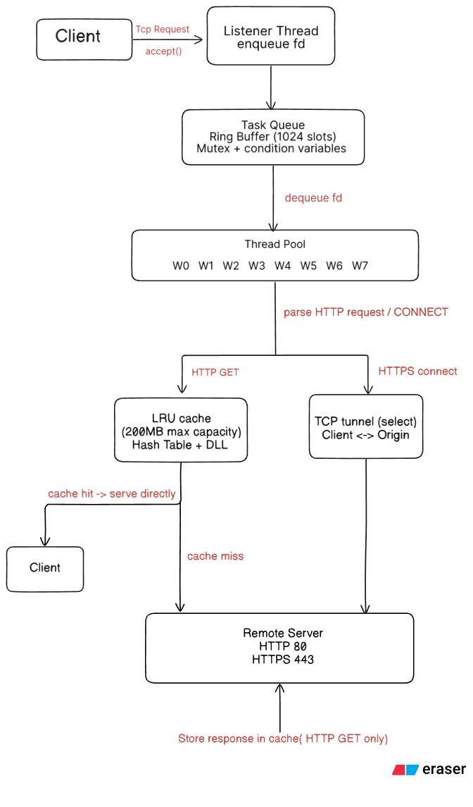
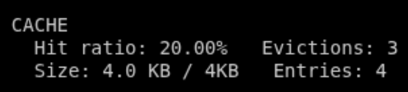

# Multi-Threaded Web Proxy Server with LRU Cache

> A concurrent forward proxy supporting HTTP/1.0 and HTTP/1.1 GET requests, HTTPS CONNECT tunneling, thread-safe LRU caching, and real-time performance monitoring.
>
> The proxy is being ported from C to Go. The **Go implementation** (`cmd/proxy`, `internal/`) is the primary build going forward. The **C implementation** (POSIX sockets + pthreads) is kept as a **legacy** reference until parity is verified, after which the C sources will be removed.

> HTTP request parsing is based on the ([Parser](https://github.com/vaibhavnaagar/proxy-server))

## Table of Contents

---

1. [Repo Structure](#repo-structure)
2. [Architecture](#architecture)
3. [Features](#features)
4. [Components](#components)
5. [Build & Run](#build&run)
6. [Results](#results)

## Repo Structure

---

```text
proxy_server
│
├── go.mod                  # Go module (primary implementation)
├── cmd
│   └── proxy
│       └── main.go         # Go entrypoint: listener, 15s reporter, SIGINT handling
├── internal
│   ├── cache               # 200MB LRU cache (map + container/list + sync.RWMutex)
│   ├── proxy               # request parsing/validation, GET proxying, CONNECT tunnel
│   └── stats               # atomic counters and stats report
│
├── main.c                  # ---- legacy C implementation below ----
├── Makefile
├── README.md
│
├── cache
│   ├── cache.c
│   └── cache.h
│
├── client_handler
│   ├── client_handler.c
│   └── client_handler.h
│
├── http
│   ├── http.c
│   └── http.h
│
├── proxy_parse
│   ├── proxy_parse.c
│   └── proxy_parse.h
│
├── server
│   ├── server.c
│   ├── server.h
│   ├── thread_pool.c
│   └── thread_pool.h
│
├── stats
│   ├── stats.c
│   └── stats.h
│
└── tests
    └── stress_test.py
```

## Architecture

---



## Features

---

### Networking

- Supports HTTP/1.0 and HTTP/1.1 GET requests
- Supports HTTPS tunneling via the CONNECT method
- Concurrent handling of multiple clients through a fixed-size worker pool
- Socket-based implementation using POSIX networking APIs

### Concurrency

- Fixed-size thread pool with 8 worker threads
- Producer-consumer architecture using a shared task queue
- Mutex and condition variable synchronization using pthreads
- Thread-safe cache and statistics modules

### LRU Cache

- Thread-safe in-memory LRU cache
- Maximum cache capacity: 200 MB
- O(1) average lookup using a hash table
- Doubly linked list for LRU ordering
- Automatic eviction of least recently used entries
- Cache hit ratio and eviction tracking

### Performance Monitoring

- Real-time request statistics
- GET and CONNECT request counters
- Cache hit ratio tracking
- Bandwidth savings measurement
- Cache occupancy and eviction metrics
- Periodic statistics reporting every 15 seconds

### Reliability

- Tested using AddressSanitizer (ASan)
- Tested using ThreadSanitizer (TSan)
- Concurrent stress testing with Python ThreadPoolExecutor

## Components

---

### Listener Thread

Accepts incoming client connections and pushes sockets into the task queue.

### Thread Pool

8 worker threads consume client sockets and process requests concurrently.

### HTTP Handler

Processes HTTP GET requests and interacts with the cache.

### HTTPS Tunnel

Handles CONNECT requests and forwards encrypted traffic between client and remote server.

### LRU Cache

Hash table + doubly linked list implementation supporting O(1) average lookup and eviction.

### Statistics Module

Tracks request counts, cache performance, bandwidth usage, and error metrics.

## Build & Run

### Go implementation (primary)

Requires Go 1.22+.

```sh
go build -o bin/proxy ./cmd/proxy   # or: make go-build
./bin/proxy <port>                  # e.g. ./bin/proxy 8080
```

Unit tests (cache eviction, request validation, CONNECT/GET port defaulting, stats accounting, GET caching and CONNECT tunneling against local test servers):

```sh
go test -race ./...                 # or: make go-test
```

Behavior:

- One goroutine per client connection (`net.Listen` + `Accept`).
- `GET` requires an absolute URI (`GET http://host[:port]/path HTTP/1.x`); port defaults to 80. The full origin response is streamed to the client and cached under `host+path` (an explicit non-80 port is included in the key).
- `CONNECT host[:port]` defaults to port 443 and relays bytes in both directions with `io.Copy`.
- Only `HTTP/1.0` and `HTTP/1.1` are accepted. Invalid requests get `400 Bad Request`; unreachable origins get `500 Internal Server Error`.
- Stats are printed every 15 seconds and once more on `SIGINT` (Ctrl+C).

### C implementation (legacy)

Kept until the Go port reaches verified parity.

```sh
make                 # builds ./proxy
make SAN=address     # AddressSanitizer build
make SAN=thread      # ThreadSanitizer build
./proxy <port>       # e.g. ./proxy 8080
```

### Stress test

Start either binary on port 8080, then:

```sh
pip install requests
python3 tests/stress_test.py
```

Set `PROXY_URL` to target a different address, e.g. `PROXY_URL=http://127.0.0.1:9090 python3 tests/stress_test.py`.

## Results

---

### 1. Concurrent HTTP & HTTPS Workload


### 2. LRU Eviction Validation

Reduced max cache size to check lru eviction

